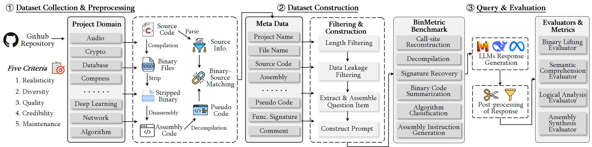

# BinMetric: A Comprehensive Binary Analysis Benchmark for Large Language Models

## Deps

pull docker image
```bash
docker pull dockcross/linux-x64:latest
```
install pypi deps
```bash
pip install -r requirements.txt
```

## Usage for users

```Python
from evaluator.data import read_problems, write_samples, generate_one_prompt
from user_impl_script import generate_one_completion
problems = read_problems()
samples = [
    dict(task_id=task_id, completion=generate_one_completion(generate_one_prompt(problem))) for problem in problems
]
write_samples(samples)
```

## Data Preprocess

1. Extract function name and address from binaries

```bash
python ext_idb_and_nameaddr.py
```

2. Extract multiple information of function from binaries
```bash
python ext_func.py
```


## Inference
We provide here scripts to infer locally deployed LLMs and call ChatGPT/GPT-4 via API.
```bash
CUDA_VISIBLE_DEVICES=0 python infer_llama.py
```

## Evaluation

```bash 
python evaluation.py --prediction_file ./queryllm/Llama-2-7b-chat-hf_prediction.json --problem_file ./problem_data.json
```

## Workflow




## License

- Code: [MIT](LICENSE)
- Benchmark data authored by us: [CC BY 4.0](DATA_LICENSE.md)
- Material from the 20 source projects remains under its original licenses: see [DATA_LICENSE.md](DATA_LICENSE.md)

## Citation

```bibtex
@inproceedings{shang2025binmetric,
  title     = {BinMetric: A Comprehensive Binary Code Analysis Benchmark for Large Language Models},
  author    = {Shang, Xiuwei and Chen, Guoqiang and Cheng, Shaoyin and others},
  booktitle = {Proceedings of the Thirty-Fourth International Joint Conference on Artificial Intelligence (IJCAI-25)},
  pages     = {7715--7723},
  year      = {2025}
}
```

